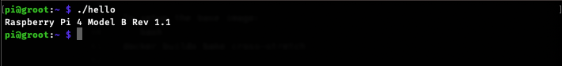
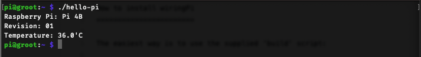

The [Raspberry Pi](https://www.raspberrypi.com/) is a popular platform for prototyping IoT products, simulating embedded environments, or running lightweight clusters.

Developing software in C or C++ for the Raspberry Pi presents several workflow choices:

1. Building directly on the board via SSH, git, or rsync.
2. Building within emulated containers on the board (which introduces significant latency when interfacing with camera and hardware peripherals).
3. Using [crosstool-ng](https://crosstool-ng.github.io/) to generate a local toolchain.
4. Using Docker and multi-stage builds to cross-compile from any host machine without needing physical hardware.

Cross-compiling with Docker Buildx offers consistent builds across macOS, Linux, and Windows, requires zero setup on the target Raspberry Pi, and exports native ARM binaries directly to your local filesystem.

## Prerequisites

Make sure you have:

1. [Docker](https://docs.docker.com/engine) >= `20.10.0`
2. [buildx](https://github.com/docker/buildx#installing) >= `v0.8.0`
3. Optional: `qemu-user` (`qemu-arm`) and `libc6-dev-armhf-cross` to test binaries locally on Linux without physical hardware.

## Setup a Docker Builder

Create and bootstrap a Buildx builder instance using the `docker-container` driver:

```bash
docker buildx create --name my-builder --driver docker-container --use
docker buildx inspect --bootstrap
```

## CMake Toolchain File

Create a toolchain file (`arm.toolchain.cmake`) to instruct CMake to cross-compile for 32-bit ARM (`arm-linux-gnueabihf`):

```cmake
# arm.toolchain.cmake
set(CMAKE_SYSTEM_NAME Linux)
set(CMAKE_SYSTEM_VERSION 1)
set(CMAKE_SYSTEM_PROCESSOR arm)

if(NOT DEFINED CMAKE_PREFIX_PATH)
  if(DEFINED ENV{CROSS_INSTALL_PREFIX})
    set(CMAKE_PREFIX_PATH $ENV{CROSS_INSTALL_PREFIX})
  elseif(DEFINED ENV{CROSS_TOOLCHAIN_PREFIX})
    set(CMAKE_PREFIX_PATH $ENV{CROSS_TOOLCHAIN_PREFIX})
  endif()
endif()

if(DEFINED ENV{CROSS_INSTALL_PREFIX})
  set(CMAKE_STAGING_PREFIX $ENV{CROSS_INSTALL_PREFIX})
endif()

if(DEFINED ENV{C_COMPILER_ARM_LINUX})
  set(CMAKE_C_COMPILER /usr/bin/$ENV{C_COMPILER_ARM_LINUX})
elseif(DEFINED ENV{GNU_HOST})
  set(CMAKE_C_COMPILER /usr/bin/$ENV{GNU_HOST}-gcc)
else()
  set(CMAKE_C_COMPILER /usr/bin/arm-linux-gnueabihf-gcc)
endif()

if(DEFINED ENV{CXX_COMPILER_ARM_LINUX})
  set(CMAKE_CXX_COMPILER /usr/bin/$ENV{CXX_COMPILER_ARM_LINUX})
elseif(DEFINED ENV{GNU_HOST})
  set(CMAKE_CXX_COMPILER /usr/bin/$ENV{GNU_HOST}-g++)
else()
  set(CMAKE_CXX_COMPILER /usr/bin/arm-linux-gnueabihf-g++)
endif()

set(CMAKE_FIND_ROOT_PATH_MODE_PROGRAM NEVER)
set(CMAKE_FIND_ROOT_PATH_MODE_LIBRARY ONLY)
set(CMAKE_FIND_ROOT_PATH_MODE_INCLUDE ONLY)
set(CMAKE_FIND_ROOT_PATH_MODE_PACKAGE ONLY)
```

## The Multi-Stage Dockerfile

Instead of juggling separate intermediate Dockerfiles, a single multi-stage `Dockerfile` provides a clean build pipeline:

1. `cross-base`: Sets up `debian:bookworm-slim` with cross-compilers (`gcc-arm-linux-gnueabihf`, `g++-arm-linux-gnueabihf`), sysroot packages (`libc6-dev-armhf-cross`), CMake, and the toolchain file.
2. `cross-pi`: Clones and cross-compiles Raspberry Pi Broadcom VideoCore IV `userland` (MMAL/VCOS/VCHIQ) and `WiringPi`, installing headers and libraries into `/usr/arm-linux-gnueabihf`.
3. `builder`: Compiles the binaries using CMake.
4. `scratch`: Exports the compiled binaries directly into `./bin` on your host.

```dockerfile
# syntax=docker/dockerfile:1
ARG DEBIAN_VERSION=bookworm-slim
FROM debian:${DEBIAN_VERSION} AS cross-base

ARG GNU_HOST=arm-linux-gnueabihf
ENV GNU_HOST=${GNU_HOST}
ENV C_COMPILER_ARM_LINUX=${GNU_HOST}-gcc
ENV CXX_COMPILER_ARM_LINUX=${GNU_HOST}-g++

ENV CROSS_INSTALL_PREFIX=/usr/${GNU_HOST}
ENV CROSS_TOOLCHAIN=/usr/local/share/cmake/arm.toolchain.cmake

RUN --mount=type=cache,target=/var/cache/apt,sharing=locked \
  --mount=type=cache,target=/var/lib/apt,sharing=locked \
  rm -f /etc/apt/apt.conf.d/docker-clean && \
  if grep -qE "bullseye|buster|stretch" /etc/os-release 2>/dev/null; then \
    sed -i 's|deb.debian.org|archive.debian.org|g' /etc/apt/sources.list && \
    sed -i 's|security.debian.org|archive.debian.org|g' /etc/apt/sources.list && \
    echo 'Acquire::Check-Valid-Until "false";' > /etc/apt/apt.conf.d/99archive; \
  fi && \
  dpkg --add-architecture armhf && \
  apt-get update && \
  apt-get --no-install-recommends install -y \
    autoconf \
    automake \
    build-essential \
    ca-certificates \
    cmake \
    curl \
    gcc-${GNU_HOST} \
    g++-${GNU_HOST} \
    git \
    gnupg \
    libc6-dev-armhf-cross \
    libcrypt-dev:armhf \
    libssl-dev \
    pkg-config \
    wget && \
  if [ -f /usr/lib/${GNU_HOST}/libcrypt.so ] && [ ! -f ${CROSS_INSTALL_PREFIX}/lib/libcrypt.so ]; then \
    mkdir -p ${CROSS_INSTALL_PREFIX}/lib && \
    ln -sf /usr/lib/${GNU_HOST}/libcrypt.so ${CROSS_INSTALL_PREFIX}/lib/libcrypt.so; \
  fi

COPY ./arm.toolchain.cmake /usr/local/share/cmake/arm.toolchain.cmake

# Raspberry Pi userland + WiringPi dependencies
FROM cross-base AS cross-pi

ARG RPI_SHA=f73fca0
ARG WIRINGPI_SHA=6d9ce35

# MMAL/VCOS (https://github.com/raspberrypi/userland)
RUN RPI_DIR=/raspberrypi && \
  RPI_BUILD_DIR=$RPI_DIR/build/arm-linux/release && \
  git clone --single-branch --branch master https://github.com/raspberrypi/userland.git $RPI_DIR && \
  cd $RPI_DIR && \
  git checkout $RPI_SHA && \
  mkdir -p $RPI_BUILD_DIR && \
  cd $RPI_BUILD_DIR && \
  cmake -DCMAKE_TOOLCHAIN_FILE=../../../makefiles/cmake/toolchains/arm-linux-gnueabihf.cmake \
    -DCMAKE_BUILD_TYPE=Release \
    ../../.. && \
  make -j `nproc` && \
  make install DESTDIR=$CROSS_INSTALL_PREFIX/ && \
  cd / && \
  rm -rf $RPI_DIR && \
  # WiringPi
  # https://github.com/WiringPi/WiringPi
  WPI_DIR=/wpi && \
  WPI_WIRING_PI_DIR=$WPI_DIR/wiringPi && \
  git clone --single-branch --branch master https://github.com/WiringPi/WiringPi.git $WPI_DIR && \
  cd $WPI_DIR && \
  git checkout $WIRINGPI_SHA && \
  cd $WPI_WIRING_PI_DIR && \
  CC=$C_COMPILER_ARM_LINUX EXTRA_CFLAGS="-fcommon" make -j `nproc` LIBS="-L/usr/lib/$GNU_HOST -L$CROSS_INSTALL_PREFIX/lib -lm -lpthread -lrt -lcrypt" && \
  make install DESTDIR=$CROSS_INSTALL_PREFIX PREFIX="" && \
  cd / && \
  rm -rf $WPI_DIR

# Standalone builder for hello
FROM cross-base AS builder-hello

WORKDIR /code
COPY ./hello.cpp ./
RUN mkdir -p /tmp/bin && \
  $CXX_COMPILER_ARM_LINUX -std=c++17 -Wall -Werror -Ofast hello.cpp -o /tmp/bin/hello

# Builder for hello-pi (and full project)
FROM cross-pi AS builder

WORKDIR /code
COPY ./hello.cpp ./hello-pi.c ./CMakeLists.txt ./

ENV BIN_DIR=/tmp/bin
ENV BUILD_DIR=/code/build

RUN mkdir -p $BIN_DIR $BUILD_DIR && \
  cd $BUILD_DIR && \
  cmake -DCMAKE_TOOLCHAIN_FILE=$CROSS_TOOLCHAIN \
    -DCMAKE_INSTALL_PREFIX=$CROSS_INSTALL_PREFIX \
    -DCMAKE_BUILD_TYPE=Release \
    .. && \
  make -j `nproc` && \
  cp ./hello ./hello-pi $BIN_DIR/

FROM scratch AS export-hello
COPY --from=builder-hello /tmp/bin/hello /hello

FROM scratch AS export-hello-pi
COPY --from=builder /tmp/bin/hello-pi /hello-pi

FROM scratch AS default
COPY --from=builder /tmp/bin/hello /hello
COPY --from=builder /tmp/bin/hello-pi /hello-pi
```

## The Applications

We will compile two demonstrative executables:

1. **`hello`** (`hello.cpp`): A C++ application reading `/sys/firmware/devicetree/base/model` to report the hardware model.
2. **`hello-pi`** (`hello-pi.c`): A C application that interfaces with board hardware via `WiringPi` and queries SoC temperature using Broadcom VideoCore IV APIs (`vc_vchi_gencmd`).

### `hello.cpp`

```cpp
// hello.cpp
#include <fstream>
#include <iostream>

int main() {
  std::string m;
  std::ifstream stream("/sys/firmware/devicetree/base/model");
  std::getline(stream, m);

  std::cout << m << std::endl;

  return 0;
}
```

### `hello-pi.c`

```c
// hello-pi.c
/*
Copyright (c) 2012, Broadcom Europe Ltd
All rights reserved.
Redistribution and use in source and binary forms, with or without
modification, are permitted provided that the following conditions are met:
    * Redistributions of source code must retain the above copyright
      notice, this list of conditions and the following disclaimer.
    * Redistributions in binary form must reproduce the above copyright
      notice, this list of conditions and the following disclaimer in the
      documentation and/or other materials provided with the distribution.
    * Neither the name of the copyright holder nor the
      names of its contributors may be used to endorse or promote products
      derived from this software without specific prior written permission.

THIS SOFTWARE IS PROVIDED BY THE COPYRIGHT HOLDERS AND CONTRIBUTORS "AS IS" AND
ANY EXPRESS OR IMPLIED WARRANTIES, INCLUDING, BUT NOT LIMITED TO, THE IMPLIED
WARRANTIES OF MERCHANTABILITY AND FITNESS FOR A PARTICULAR PURPOSE ARE
DISCLAIMED. IN NO EVENT SHALL THE COPYRIGHT HOLDER OR CONTRIBUTORS BE LIABLE FOR ANY
DIRECT, INDIRECT, INCIDENTAL, SPECIAL, EXEMPLARY, OR CONSEQUENTIAL DAMAGES
(INCLUDING, BUT NOT LIMITED TO, PROCUREMENT OF SUBSTITUTE GOODS OR SERVICES;
LOSS OF USE, DATA, OR PROFITS; OR BUSINESS INTERRUPTION) HOWEVER CAUSED AND
ON ANY THEORY OF LIABILITY, WHETHER IN CONTRACT, STRICT LIABILITY, OR TORT
(INCLUDING NEGLIGENCE OR OTHERWISE) ARISING IN ANY WAY OUT OF THE USE OF THIS
SOFTWARE, EVEN IF ADVISED OF THE POSSIBILITY OF SUCH DAMAGE.
*/

#include <stdio.h>
#include <stdlib.h>
#include <string.h>
#include <wiringPi.h>

#include "interface/vmcs_host/vc_gencmd_defs.h"
#include "interface/vmcs_host/vc_vchi_gencmd.h"

#define TEMP_KEY_SIZE 5

void chop(char* str, size_t n);

int main() {
  // Get board model
  int m, rev, mem, maker, ov;
  piBoardId(&m, &rev, &mem, &maker, &ov);

  printf("Raspberry Pi: %s\n", piModelNames[m]);
  printf("Revision: %s\n", piRevisionNames[rev]);

  // Get SoC temperature
  // https://github.com/raspberrypi/userland/blob/master/host_applications/linux/apps/gencmd/gencmd.c
  // vcgencmd measure_temp
  VCHI_INSTANCE_T vchi_instance;
  VCHI_CONNECTION_T* vchi_connection = NULL;

  vcos_init();

  if (vchi_initialise(&vchi_instance) != 0) {
    fprintf(stderr, "VCHI init failed\n");
    return 1;
  }

  // Create a vchi connection
  if (vchi_connect(NULL, 0, vchi_instance) != 0) {
    fprintf(stderr, "VCHI connect failed\n");
    return 1;
  }

  vc_vchi_gencmd_init(vchi_instance, &vchi_connection, 1);

  char buffer[GENCMDSERVICE_MSGFIFO_SIZE];
  size_t buffer_offset = 0;
  int ret;

  // Reset the buffer
  buffer[0] = '\0';

  // Set the cmd
  buffer_offset = vcos_safe_strcpy(buffer, "measure_temp", sizeof(buffer), buffer_offset);

  // Send the gencmd for the argument
  if ((ret = vc_gencmd_send("%s", buffer)) != 0) {
    printf("vc_gencmd_send returned non-zero code: %d\n", ret);
    return 1;
  }

  // Get + print out the response
  if ((ret = vc_gencmd_read_response(buffer, sizeof(buffer))) != 0) {
    printf("vc_gencmd_read_response returned a non-zero code: %d\n", ret);
    return 1;
  }
  buffer[sizeof(buffer) - 1] = 0;

  if (buffer[0] != '\0') {
    if (strncmp(buffer, "temp=", TEMP_KEY_SIZE) == 0) {
      chop(buffer, TEMP_KEY_SIZE);
      printf("Temperature: %s\n", buffer);
    } else
      puts(buffer);
  }

  vc_gencmd_stop();

  // Close the vchi connection
  if (vchi_disconnect(vchi_instance) != 0) {
    fprintf(stderr, "VCHI disconnect failed\n");
    return 1;
  }

  return 0;
}

void chop(char* str, size_t n) {
  size_t len = strlen(str);
  if (n > len) return;
  memmove(str, str + n, len - n + 1);
}
```

### `CMakeLists.txt`

The CMake project defines both targets using modern target-oriented properties:

```cmake
# CMakeLists.txt
cmake_minimum_required(VERSION 3.16)

project(hello-pi C CXX)

set(CMAKE_MODULE_PATH ${CMAKE_MODULE_PATH} ${CMAKE_INSTALL_PREFIX}/lib/cmake/ /usr/lib/cmake)
set(VC_INST_PATH ${CMAKE_PREFIX_PATH}/opt/vc)
set(VC_LIBS ${VC_INST_PATH}/lib)
set(VC_INCLUDES ${VC_INST_PATH}/include)
set(VCOS_PLATFORM pthreads)

find_library(mmalcore_LIBS NAMES mmal_core PATHS "${VC_LIBS}")
find_library(mmalutil_LIBS NAMES mmal_util PATHS "${VC_LIBS}")
find_library(mmal_LIBS NAMES mmal PATHS "${VC_LIBS}")
if((NOT mmal_LIBS) OR (NOT mmalutil_LIBS) OR (NOT mmalcore_LIBS))
  message(FATAL_ERROR "Could not find mmal libs")
endif()

find_path(vmcs_host_INC NAMES vmcs_host PATHS "${VC_INCLUDES}/interface")
if(NOT vmcs_host_INC)
  message(FATAL_ERROR "Could not find vmcs_host interfaces")
endif()

find_library(vchostif_LIBS NAMES vchostif PATHS "${VC_LIBS}")
find_library(vchiq_arm_LIBS NAMES vchiq_arm PATHS "${VC_LIBS}")
find_library(vcos_LIBS NAMES vcos PATHS "${VC_LIBS}")
if((NOT vcos_LIBS) OR (NOT vchiq_arm_LIBS) OR (NOT vchostif_LIBS))
  message(FATAL_ERROR "Could not find vcos/vchiq_arm/vchostif libs")
endif()

find_library(wiringPi_LIB NAMES wiringPi)
if(NOT wiringPi_LIB)
  message(FATAL_ERROR "Could not find wiringPi")
endif()

# Target: hello (standard C++ Raspberry Pi model reader)
add_executable(hello hello.cpp)
target_compile_features(hello PRIVATE cxx_std_17)
target_compile_options(hello PRIVATE -Wall -Werror -Ofast)

# Target: hello-pi (C application using Broadcom VideoCore and WiringPi)
add_executable(hello-pi hello-pi.c)
target_compile_options(hello-pi PRIVATE -Wall -Werror)
target_include_directories(hello-pi PRIVATE
  ${VC_INCLUDES}
  ${VC_INCLUDES}/interface/vcos
  ${VC_INCLUDES}/interface/vcos/${VCOS_PLATFORM}
)
target_link_libraries(hello-pi PRIVATE
  pthread
  ${vcos_LIBS}
  ${vchiq_arm_LIBS}
  ${vchostif_LIBS}
  ${wiringPi_LIB}
)
```

## Compiling with Docker Buildx Bake

To streamline building multiple targets, configure `docker-bake.hcl`:

```hcl
variable "DEST" {
  default = "./bin"
}

variable "CACHE" {
  default = "./tmp/cache"
}

variable "GNU_HOST" {
  default = "arm-linux-gnueabihf"
}

variable "DEBIAN_VERSION" {
  default = "bookworm-slim"
}

group "default" {
  targets = ["default"]
}

group "all" {
  targets = ["hello", "hello-pi"]
}

target "cross-base" {
  dockerfile = "Dockerfile"
  target     = "cross-base"
  tags       = ["cross-base:latest"]
  cache-from = ["type=local,src=${CACHE}-base"]
  cache-to   = ["type=local,mode=max,dest=${CACHE}-base"]
  args = {
    DEBIAN_VERSION = "${DEBIAN_VERSION}"
    GNU_HOST       = "${GNU_HOST}"
  }
}

target "cross-pi" {
  dockerfile = "Dockerfile"
  target     = "cross-pi"
  tags       = ["cross-pi:latest"]
  cache-from = ["type=local,src=${CACHE}-pi"]
  cache-to   = ["type=local,mode=max,dest=${CACHE}-pi"]
  args = {
    DEBIAN_VERSION = "${DEBIAN_VERSION}"
    GNU_HOST       = "${GNU_HOST}"
  }
}

target "default" {
  dockerfile = "Dockerfile"
  target     = "default"
  cache-from = ["type=local,src=${CACHE}"]
  cache-to   = ["type=local,mode=max,dest=${CACHE}"]
  output     = ["${DEST}"]
  args = {
    DEBIAN_VERSION = "${DEBIAN_VERSION}"
    GNU_HOST       = "${GNU_HOST}"
  }
}

target "hello" {
  dockerfile = "Dockerfile"
  target     = "export-hello"
  cache-from = ["type=local,src=${CACHE}-hello"]
  cache-to   = ["type=local,mode=max,dest=${CACHE}-hello"]
  output     = ["${DEST}"]
  args = {
    DEBIAN_VERSION = "${DEBIAN_VERSION}"
    GNU_HOST       = "${GNU_HOST}"
  }
}

target "hello-pi" {
  dockerfile = "Dockerfile"
  target     = "export-hello-pi"
  cache-from = ["type=local,src=${CACHE}-hello-pi"]
  cache-to   = ["type=local,mode=max,dest=${CACHE}-hello-pi"]
  output     = ["${DEST}"]
  args = {
    DEBIAN_VERSION = "${DEBIAN_VERSION}"
    GNU_HOST       = "${GNU_HOST}"
  }
}
```

Compile both binaries into `./bin`:

```bash
docker buildx bake
```

Or compile individual targets:

```bash
docker buildx bake hello
docker buildx bake hello-pi
```

You can also use `docker buildx build` directly:

```bash
docker buildx build -f Dockerfile -o type=local,dest=./bin .
```

## Running and Verifying Binaries

Copy the compiled binaries in `./bin` to your Raspberry Pi:

```bash
# Output from hello
./bin/hello
```



```bash
# Output from hello-pi
./bin/hello-pi
```



### Emulation Testing with QEMU

You can also verify binary headers and dynamic linking locally on Linux without hardware using QEMU user emulation:

```bash
# Check ELF architecture
file ./bin/hello
file ./bin/hello-pi

# Run hello (verifies 32-bit ARM ELF execution and glibc matching)
qemu-arm -L /usr/arm-linux-gnueabihf/ ./bin/hello
```


`hello` depends only on standard C++ and libc, so it executes cleanly under QEMU. `hello-pi` dynamically links against Broadcom VideoCore IV (`libvcos.so`, `libvchiq_arm.so`) and `libwiringPi.so`, which reside on physical Raspberry Pi OS (or require those libraries in `LD_LIBRARY_PATH`).


All the source code and CI workflows are available at [rolandjitsu/raspi-cross](https://github.com/rolandjitsu/raspi-cross).
