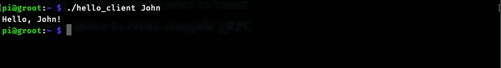
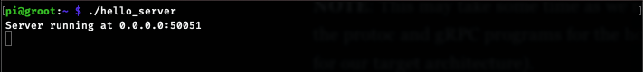

If you are building a microservice architecture, you will likely use some networking library to manage service communication.

This is where [gRPC](https://www.grpc.io/) fits in. Interoperability across different languages is one of its strongest points, backed by extensive [documentation](https://www.grpc.io/docs/languages/) and a large ecosystem.

Cross-compiling C++ applications that rely on gRPC for a different architecture (such as 32-bit ARM `armhf` or 64-bit ARM `aarch64`) is non-trivial because of code generation:

1. **Host tools**: gRPC code generators (`protoc` and `grpc_cpp_plugin`) must execute natively on the build machine during compilation to produce C++ protobuf and gRPC stub files (`hello.pb.cc`, `hello.grpc.pb.cc`).
2. **Target libraries**: The gRPC runtime libraries, Abseil, and SSL dependencies must be compiled with the target cross-compiler (`arm-linux-gnueabihf-g++` or `aarch64-linux-gnu-g++`) and staged in a sysroot prefix.
3. **Application build**: The application CMake build loads target libraries from the staging prefix while executing the host code generators to produce the final ARM executables.

The official gRPC repo includes a [cross-compilation example](https://github.com/grpc/grpc/blob/master/test/distrib/cpp/run_distrib_test_raspberry_pi.sh). This guide modernizes that workflow using Docker Buildx, Debian Bookworm, and CMake, supporting both 32-bit and 64-bit ARM architectures.


This walkthrough targets modern gRPC (v1.66) on Debian Bookworm with C++17. If your production environment requires older releases, the accompanying repository also preserves support for legacy gRPC (v1.37 on Debian Bullseye).


## Prerequisites

Make sure you have:

1. [Docker](https://docs.docker.com/engine) >= `20.10` with [Buildx](https://github.com/docker/buildx), or [Podman](https://podman.io/) / [Buildah](https://buildah.io/)
2. Optional: `qemu-user` (`qemu-arm` and `qemu-aarch64`) if you want to test binaries locally without physical ARM hardware

## Setup a Docker builder

Create and bootstrap a Buildx container builder:

```bash
docker buildx create --name my-builder --driver docker-container --use
docker buildx inspect --bootstrap
```

## CMake Toolchain File

Debian cross-compilers include built-in sysroots. Setting `CMAKE_SYSROOT` explicitly causes GNU `ld` to prepend the sysroot path to Debian linker scripts, resulting in `cannot find libc.so.6 inside sysroot` errors.

Create a clean toolchain file (`arm.toolchain.cmake`) that detects the target processor dynamically:

```cmake
# arm.toolchain.cmake
set(CMAKE_SYSTEM_NAME Linux)
set(CMAKE_SYSTEM_VERSION 1)

if(DEFINED ENV{CMAKE_SYSTEM_PROCESSOR})
  set(CMAKE_SYSTEM_PROCESSOR $ENV{CMAKE_SYSTEM_PROCESSOR})
elseif(DEFINED ENV{GNU_HOST} AND "$ENV{GNU_HOST}" MATCHES "^aarch64")
  set(CMAKE_SYSTEM_PROCESSOR aarch64)
else()
  set(CMAKE_SYSTEM_PROCESSOR arm)
endif()

# Sysroots are built into Debian cross-compilers; only set if an external sysroot exists
if(DEFINED ENV{CMAKE_SYSROOT})
  set(CMAKE_SYSROOT $ENV{CMAKE_SYSROOT})
elseif(DEFINED ENV{CROSS_TOOLCHAIN} AND EXISTS "$ENV{CROSS_TOOLCHAIN}/sysroot")
  set(CMAKE_SYSROOT $ENV{CROSS_TOOLCHAIN}/sysroot)
endif()

if(DEFINED ENV{CROSS_STAGING_PREFIX})
  set(CMAKE_STAGING_PREFIX $ENV{CROSS_STAGING_PREFIX})
else()
  message(FATAL_ERROR "CROSS_STAGING_PREFIX env var is missing")
endif()

if(DEFINED ENV{GNU_HOST})
  set(CMAKE_C_COMPILER /usr/bin/$ENV{GNU_HOST}-gcc)
  set(CMAKE_CXX_COMPILER /usr/bin/$ENV{GNU_HOST}-g++)
else()
  message(FATAL_ERROR "GNU_HOST env var is missing")
endif()

set(CMAKE_FIND_ROOT_PATH_MODE_PROGRAM NEVER)
set(CMAKE_FIND_ROOT_PATH_MODE_LIBRARY ONLY)
set(CMAKE_FIND_ROOT_PATH_MODE_INCLUDE ONLY)
set(CMAKE_FIND_ROOT_PATH_MODE_PACKAGE ONLY)
```

## Setup the Multi-Stage Dockerfile

The Dockerfile uses three stages:

1. `cross-grpc`: Builds host code generators, then cross-compiles gRPC and its bundled dependencies into a staging prefix (`$CROSS_STAGING_PREFIX`).
2. `builder`: Compiles the application by invoking host `protoc` and linking staged target libraries.
3. `scratch`: Exports the compiled ARM binaries back to the host filesystem.

```dockerfile
# syntax=docker/dockerfile:1
ARG DEBIAN_VERSION=bookworm-slim
FROM debian:${DEBIAN_VERSION} AS cross-grpc

ARG GNU_HOST=arm-linux-gnueabihf
ENV GNU_HOST=${GNU_HOST}

RUN --mount=type=cache,target=/var/cache/apt,sharing=locked \
  --mount=type=cache,target=/var/lib/apt,sharing=locked \
  rm -f /etc/apt/apt.conf.d/docker-clean && \
  if grep -qE "bullseye|buster" /etc/os-release 2>/dev/null; then \
    sed -i 's|deb.debian.org|archive.debian.org|g' /etc/apt/sources.list && \
    sed -i 's|security.debian.org|archive.debian.org|g' /etc/apt/sources.list && \
    echo 'Acquire::Check-Valid-Until "false";' > /etc/apt/apt.conf.d/99archive; \
  fi && \
  apt-get update && \
  apt-get --no-install-recommends install -y \
    autoconf \
    automake \
    build-essential \
    ca-certificates \
    cmake \
    gcc-$GNU_HOST \
    g++-$GNU_HOST \
    git \
    gnupg \
    libc6-dev-armhf-cross \
    libc6-dev-arm64-cross \
    libssl-dev \
    libtool \
    pkg-config \
    software-properties-common \
    wget

ENV C_COMPILER_ARM_LINUX=$GNU_HOST-gcc
ENV CXX_COMPILER_ARM_LINUX=$GNU_HOST-g++

ENV CROSS_TOOLCHAIN=/usr/$GNU_HOST
ENV CROSS_STAGING_PREFIX=$CROSS_TOOLCHAIN/stage
ENV CMAKE_CROSS_TOOLCHAIN=/usr/local/share/cmake/arm.toolchain.cmake

COPY ./arm.toolchain.cmake /usr/local/share/cmake/arm.toolchain.cmake

ARG GRPC_VERSION=v1.66.2
ENV GRPC_VERSION=${GRPC_VERSION}

RUN GRPC_DIR=/grpc && \
  git clone --depth 1 --branch $GRPC_VERSION --recursive --shallow-submodules https://github.com/grpc/grpc.git $GRPC_DIR && \
  # 1. Host build (installs protoc and grpc_cpp_plugin to /usr/local/bin)
  GRPC_BUILD_DIR=$GRPC_DIR/cmake/build && \
  mkdir -p $GRPC_BUILD_DIR && \
  cd $GRPC_BUILD_DIR && \
  cmake \
    -DCMAKE_BUILD_TYPE=Release \
    -DCMAKE_CXX_STANDARD=17 \
    -DgRPC_INSTALL=ON \
    -DgRPC_BUILD_TESTS=OFF \
    -DgRPC_SSL_PROVIDER=package \
    ../.. && \
  make -j`nproc` install && \
  # Build host Abseil if not installed by gRPC (e.g. legacy v1.37.1)
  if [ ! -f /usr/local/lib/cmake/absl/abslConfig.cmake ] && [ -d "$GRPC_DIR/third_party/abseil-cpp" ]; then \
    ABSEIL_BUILD_DIR=$GRPC_DIR/third_party/abseil-cpp/cmake/build && \
    mkdir -p $ABSEIL_BUILD_DIR && \
    cd $ABSEIL_BUILD_DIR && \
    cmake -DCMAKE_BUILD_TYPE=Release \
      -DCMAKE_CXX_STANDARD=17 \
      -DCMAKE_POSITION_INDEPENDENT_CODE=TRUE \
      ../.. && \
    make -j`nproc` install; \
  fi && \
  # 2. Target cross-compilation into CROSS_STAGING_PREFIX
  GRPC_CROSS_BUILD_DIR=$GRPC_DIR/cmake/cross_build && \
  mkdir -p $GRPC_CROSS_BUILD_DIR && \
  cd $GRPC_CROSS_BUILD_DIR && \
  cmake -DCMAKE_TOOLCHAIN_FILE=$CMAKE_CROSS_TOOLCHAIN \
    -DCMAKE_BUILD_TYPE=Release \
    -DCMAKE_CXX_STANDARD=17 \
    -DCMAKE_INSTALL_PREFIX=$CROSS_STAGING_PREFIX \
    -DgRPC_INSTALL=ON \
    -DgRPC_BUILD_TESTS=OFF \
    ../.. && \
  make -j`nproc` install && \
  # Build cross Abseil if not installed by gRPC (ensuring C++17 matches gRPC ABI)
  if [ ! -f "$CROSS_STAGING_PREFIX/lib/cmake/absl/abslConfig.cmake" ] && [ -d "$GRPC_DIR/third_party/abseil-cpp" ]; then \
    ABSEIL_BUILD_DIR=$GRPC_DIR/third_party/abseil-cpp/cmake/build_cross && \
    mkdir -p $ABSEIL_BUILD_DIR && \
    cd $ABSEIL_BUILD_DIR && \
    cmake -DCMAKE_TOOLCHAIN_FILE=$CMAKE_CROSS_TOOLCHAIN \
      -DCMAKE_BUILD_TYPE=Release \
      -DCMAKE_CXX_STANDARD=17 \
      -DCMAKE_INSTALL_PREFIX=$CROSS_STAGING_PREFIX \
      -DCMAKE_POSITION_INDEPENDENT_CODE=TRUE \
      ../.. && \
    make -j`nproc` install; \
  fi && \
  cd / && \
  rm -rf $GRPC_DIR

FROM cross-grpc AS builder

WORKDIR /code
COPY ./src/. .

ENV BIN_DIR=/tmp/bin
ENV BUILD_DIR=./build

RUN mkdir -p $BIN_DIR && \
  mkdir -p $BUILD_DIR && \
  cd ./$BUILD_DIR && \
  cmake -DCMAKE_TOOLCHAIN_FILE=$CMAKE_CROSS_TOOLCHAIN \
    -DCMAKE_BUILD_TYPE=Release \
    -DCMAKE_PREFIX_PATH=$CROSS_STAGING_PREFIX \
    -Dabsl_DIR=$CROSS_STAGING_PREFIX/lib/cmake/absl \
    -DProtobuf_DIR=$CROSS_STAGING_PREFIX/lib/cmake/protobuf \
    -Dutf8_range_DIR=$CROSS_STAGING_PREFIX/lib/cmake/utf8_range \
    -DgRPC_DIR=$CROSS_STAGING_PREFIX/lib/cmake/grpc \
    -D_PROTOBUF_PROTOC=/usr/local/bin/protoc \
    -D_GRPC_CPP_PLUGIN_EXECUTABLE=/usr/local/bin/grpc_cpp_plugin \
    .. && \
  make -j`nproc` && \
  cp ./hello_* $BIN_DIR/

FROM scratch
COPY --from=builder /tmp/bin /
```

## Write the Application

Create a protobuf service definition:

```proto
// src/hello.proto
syntax = "proto3";

package hello;

service Greeter {
  rpc SayHello(Req) returns (Rep) {}
}

message Req {
  string name = 1;
}

message Rep {
  string message = 1;
}
```

The server implementation:

```cpp
// src/hello_server.cc
#include <grpcpp/ext/proto_server_reflection_plugin.h>
#include <grpcpp/grpcpp.h>
#include <grpcpp/health_check_service_interface.h>

#include <iostream>
#include <memory>
#include <string>

#include "hello.grpc.pb.h"

class GreeterService final : public hello::Greeter::Service {
  grpc::Status SayHello(grpc::ServerContext* ctx, const hello::Req* req, hello::Rep* rep) override {
    std::string prefix("Hello, ");
    std::string suffix("!");
    rep->set_message(prefix + req->name() + suffix);
    return grpc::Status::OK;
  }
};

void RunServer() {
  std::string addr("0.0.0.0:50051");
  GreeterService service;

  grpc::EnableDefaultHealthCheckService(true);
  grpc::reflection::InitProtoReflectionServerBuilderPlugin();

  grpc::ServerBuilder builder;
  builder.AddListeningPort(addr, grpc::InsecureServerCredentials());
  builder.RegisterService(&service);

  std::unique_ptr<grpc::Server> server(builder.BuildAndStart());
  std::cout << "Server running at " << addr << std::endl;
  server->Wait();
}

int main(int argc, char** argv) {
  RunServer();
  return 0;
}
```

The client implementation:

```cpp
// src/hello_client.cc
#include <ctype.h>
#include <grpcpp/grpcpp.h>
#include <stdio.h>
#include <stdlib.h>

#include <iostream>
#include <memory>
#include <string>

#include "hello.grpc.pb.h"

class GreeterClient {
 public:
  GreeterClient(std::shared_ptr<grpc::Channel> channel) : stub_(hello::Greeter::NewStub(channel)) {}

  std::string SayHello(const std::string& name) {
    hello::Req req;
    req.set_name(name);

    hello::Rep rep;
    grpc::ClientContext context;

    grpc::Status status = stub_->SayHello(&context, req, &rep);

    if (status.ok()) {
      return rep.message();
    } else {
      std::cout << "Error " << status.error_code() << ": " << status.error_message() << std::endl;
      return "RPC failed";
    }
  }

 private:
  std::unique_ptr<hello::Greeter::Stub> stub_;
};

int main(int argc, char** argv) {
  std::string addr("127.0.0.1:50051");

  std::string name("stranger");
  if (argc > 1) {
    name = std::string(argv[1]);
  }

  GreeterClient client(grpc::CreateChannel(addr, grpc::InsecureChannelCredentials()));
  std::string rep = client.SayHello(name);
  std::cout << rep << std::endl;

  return 0;
}
```

The CMake build configuration:

```cmake
# src/CMakeLists.txt
cmake_minimum_required(VERSION 3.16)

if(POLICY CMP0077)
  cmake_policy(SET CMP0077 NEW)
endif()

project(hello C CXX)

set(CMAKE_CXX_STANDARD 17)
set(CMAKE_CXX_STANDARD_REQUIRED ON)

find_package(Threads REQUIRED)

set(protobuf_MODULE_COMPATIBLE TRUE)
find_package(Protobuf CONFIG REQUIRED)
message(STATUS "Using protobuf ${Protobuf_VERSION}")

set(_PROTOBUF_LIBPROTOBUF protobuf::libprotobuf)
set(_REFLECTION gRPC::grpc++_reflection)

# Ensure find_program searches host PATH and skips cross-staging directories
find_program(_PROTOBUF_PROTOC protoc NO_CMAKE_PATH NO_CMAKE_ENVIRONMENT_PATH)
if(NOT _PROTOBUF_PROTOC)
  find_program(_PROTOBUF_PROTOC protoc)
endif()

find_package(gRPC CONFIG REQUIRED)
message(STATUS "Using gRPC ${gRPC_VERSION}")

set(_GRPC_GRPCPP gRPC::grpc++)
find_program(_GRPC_CPP_PLUGIN_EXECUTABLE grpc_cpp_plugin NO_CMAKE_PATH NO_CMAKE_ENVIRONMENT_PATH)
if(NOT _GRPC_CPP_PLUGIN_EXECUTABLE)
  find_program(_GRPC_CPP_PLUGIN_EXECUTABLE grpc_cpp_plugin)
endif()

# Code generation
get_filename_component(h_proto "hello.proto" ABSOLUTE)
get_filename_component(h_proto_path "${h_proto}" PATH)

set(h_proto_srcs "${CMAKE_CURRENT_BINARY_DIR}/hello.pb.cc")
set(h_proto_hdrs "${CMAKE_CURRENT_BINARY_DIR}/hello.pb.h")
set(h_grpc_srcs "${CMAKE_CURRENT_BINARY_DIR}/hello.grpc.pb.cc")
set(h_grpc_hdrs "${CMAKE_CURRENT_BINARY_DIR}/hello.grpc.pb.h")

add_custom_command(
  OUTPUT "${h_proto_srcs}" "${h_proto_hdrs}" "${h_grpc_srcs}" "${h_grpc_hdrs}"
  COMMAND ${_PROTOBUF_PROTOC}
  ARGS --grpc_out "${CMAKE_CURRENT_BINARY_DIR}"
    --cpp_out "${CMAKE_CURRENT_BINARY_DIR}"
    -I "${h_proto_path}"
    --plugin=protoc-gen-grpc="${_GRPC_CPP_PLUGIN_EXECUTABLE}"
    "${h_proto}"
  DEPENDS "${h_proto}")

include_directories("${CMAKE_CURRENT_BINARY_DIR}")

foreach(_target hello_client hello_server)
  add_executable(${_target} "${_target}.cc"
    ${h_proto_srcs}
    ${h_grpc_srcs})
  target_link_libraries(${_target}
    ${_REFLECTION}
    ${_GRPC_GRPCPP}
    ${_PROTOBUF_LIBPROTOBUF})
endforeach()
```

## Compiling the Binaries

### Direct Buildx Build

To compile 32-bit ARM binaries directly:

```bash
docker buildx build -f Dockerfile -o type=local,dest=./bin .
```

To compile 64-bit ARM binaries (`aarch64`):

```bash
docker buildx build --build-arg GNU_HOST=aarch64-linux-gnu -f Dockerfile -o type=local,dest=./bin/aarch64 .
```

### Docker Buildx Bake (Recommended)

Using Bake simplifies multi-architecture targets and caching:

```bash
# Default build (32-bit ARM into ./bin)
docker buildx bake

# Target 32-bit ARM (output to ./bin/armhf)
docker buildx bake armhf

# Target 64-bit ARM (output to ./bin/aarch64)
docker buildx bake aarch64

# Build both architectures in parallel
docker buildx bake all

# Build legacy gRPC v1.37 on Debian Bullseye
docker buildx bake legacy
```

### Podman and Buildah

If you prefer daemonless container tools, Podman and Buildah export local binaries without Docker:

```bash
# Podman (32-bit ARM)
podman build -o type=local,dest=./bin .

# Podman (64-bit ARM)
podman build --build-arg GNU_HOST=aarch64-linux-gnu -o type=local,dest=./bin/aarch64 .

# Buildah
buildah build --output type=local,dest=./bin .
```

## Verifying Binaries with QEMU (No Hardware Required)

You do not need a physical Raspberry Pi or ARM board to test the compiled binaries. On Linux or CI environments, install `qemu-user` and dynamic linker sysroots:

```bash
# On Ubuntu / Debian hosts
sudo apt-get install -y qemu-user libc6-dev-armhf-cross libc6-dev-arm64-cross
```

Test 32-bit ARM binaries:

```bash
# Start server in background
qemu-arm -L /usr/arm-linux-gnueabihf/ ./bin/hello_server &
SERVER_PID=$!
sleep 1

# Execute client
out=$(qemu-arm -L /usr/arm-linux-gnueabihf/ ./bin/hello_client John)
echo "$out"  # Expected: "Hello, John!"

kill $SERVER_PID 2>/dev/null || true
```

Test 64-bit ARM binaries:

```bash
# Start server in background
qemu-aarch64 -L /usr/aarch64-linux-gnu/ ./bin/aarch64/hello_server &
SERVER_PID=$!
sleep 1

# Execute client
out=$(qemu-aarch64 -L /usr/aarch64-linux-gnu/ ./bin/aarch64/hello_client John)
echo "$out"  # Expected: "Hello, John!"

kill $SERVER_PID 2>/dev/null || true
```

When running natively on an ARM host, you should see the same expected output:





All code, configurations, toolchain files, and GitHub Actions CI pipelines can be found in the [rolandjitsu/grpc-cross-arm](https://github.com/rolandjitsu/grpc-cross-arm) repository.
