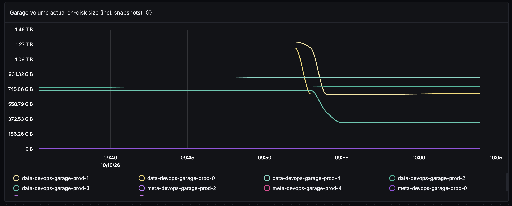

For the past month or so I've been rolling out a scalable, high-throughput OCI registry for our CI: [Harbor](https://goharbor.io) as the registry, [Garage](https://garagehq.deuxfleurs.fr) as the S3 storage behind it, on Kubernetes with [Longhorn](https://longhorn.io) providing the volumes (that has since changed, but it's the setup this story happened on). That journey is worth a few posts on its own (and I plan to write them, at some point), but this one is about a single thing that caught me off guard on a Saturday morning: **deleting data does not free disk space**. Not on Longhorn, and not on most thin-provisioned storage - until something explicitly tells the layer below which blocks are no longer in use.

So, here's how I spent my Saturday morning, trying to prevent yet another incident.

## The context

CI pushes images around the clock, and the registry's storage had not kept up with the inflow - we'd already grown the Garage data volumes twice (800Gi -> 1200Gi -> 1900Gi) and they kept refilling. The fix was to expand the disks again with enough storage to accommodate the inflow and image retention policy, so we scheduled that for a Friday: one node at a time, registry live, Garage replicates everything 3 ways, what could go wrong.

It required rebooting the VMs, and when we took the first node down, some image blobs turned out to be reachable only through that node - pulls started failing with `blob unknown`, and CI jobs with them. With 3-way replication that should have been a non-event; why it wasn't is a story for a follow-up post (short version: a recent 3 -> 5 node expansion had left some blocks under-replicated). We put the node back about an hour and a half later, having gained exactly zero bytes.

It was Friday afternoon, so retrying meant the weekend or the following week. Plan B: a much tighter retention policy (keep nothing that wasn't pulled in the last 24h) and a garbage collection run overnight. That de-referenced about **1.5TB** of blobs, and Harbor's GC deleted them from storage. We should have had plenty of headroom for a quiet weekend.

## Saturday morning

Saturday, 09:12, coffee in hand, I checked the dashboards. Two of the five nodes were at **95.4%** and **97.8%** disk used - 97GB and 46GB left, on 2TB disks. At our inflow rate, that was hours, at best.

Running a node to 100% was not a theoretical concern. A few days earlier, a different disk filled up completely, and Garage's metadata DB on it got corrupted (`MDB_CORRUPTED: Located page was wrong type`) - a full Longhorn disk fails writes with `EIO`, not `ENOSPC`, so [LMDB](https://garagehq.deuxfleurs.fr/documentation/reference-manual/configuration/#db-engine-since-v0-8-0) never got told "disk full", just hours of failed I/O. Recovering meant deleting the DB and letting the node rebuild its metadata from peers. I was not keen on doing that surgery again, twice, on a weekend.

But here's the part that didn't add up: Garage's own stats said its data was only **~40% of the disk** - about 1.2TB free out of 2TB. The retention policy had worked, the GC had worked, Garage had processed the deletes overnight. Harbor said the data was gone. Garage said the data was gone.

The disks said nothing was gone. 🤯

## Suspect #1: Garage

My first thought was that Garage hadn't actually erased the blocks yet. That's a real thing: the [Garage internals doc](https://garagehq.deuxfleurs.fr/documentation/design/internals/) explains it deliberately delays block deletion (blocks are never erased within 10 minutes of their reference count reaching zero, to avoid race conditions), and rebalancing can defer cleanup further.

But every metric said otherwise. The resync queue was small and draining, with zero errors. The GC queues were being drained. And the clearest signal: Garage's view of its own data directory already reflected the deletes. Garage wasn't holding on to anything - whatever was eating the disk was sitting *below* Garage.

## Suspect #2: the layer below

Below Garage's data directory is an ext4 filesystem on a Longhorn volume. A few minutes of digging landed me on [Longhorn's space consumption guideline](https://longhorn.io/kb/space-consumption-guideline/#filesystem-used-size-is-much-smaller-than-volume-actual-size):

> Deleting a file is a filesystem layer operation that does not actually free up blocks from the underlying volume.

That was it.

A Longhorn volume is a thin-provisioned block device: the replicas are sparse files that allocate a block the first time it's written and never give it back on their own. When ext4 deletes a file, it marks the blocks free *in its own bitmap* - the block device under it is never told. So the volume's actual on-disk size never shrinks on delete; it only grows. Our disks weren't full of live data - they were holding every block the filesystem had ever written to, deleted ones included.

The filesystem has a way to pass the message down: [`fstrim`](https://man7.org/linux/man-pages/man8/fstrim.8.html) (or the `discard` mount option), which tells the block layer which blocks are free so it can release them - and Longhorn has a way to do that too. On a regular Linux box you rarely think about this because most distros run `fstrim.timer` weekly. A Longhorn PV gets none of that by default: our StorageClass had no `discard` mount option, and nothing was running trims - or if anything ever did, not often enough to matter.

## Running the trim

Longhorn has supported trim since v1.4.0, and exposes it as a volume action (it's also a button in the UI - `Trim Filesystem` - see [the docs](https://longhorn.io/docs/1.10.0/nodes-and-volumes/volumes/trim-filesystem/)). Via the API:

```sh
# volume names: kubectl -n longhorn-system get volumes.longhorn.io
kubectl -n longhorn-system port-forward svc/longhorn-backend 9500:9500 &
curl -X POST "http://localhost:9500/v1/volumes/<volume>?action=trimFilesystem"
```

One caveat before it worked on both nodes: **snapshots pin blocks**. Longhorn snapshots are immutable, so trim can only reclaim from the volume head - one of the two full volumes had a stale 184GB snapshot from an earlier expansion, and that had to be deleted first:

```sh
kubectl -n longhorn-system delete snapshots.longhorn.io <snapshot>
```

(There's a global setting, `remove-snapshots-during-filesystem-trim`, that marks snapshots as removed automatically during trim. We keep it off; I'd rather delete snapshots explicitly than have a trim quietly do it.)


Trim works online, while the volume is attached and serving traffic - and it works on a 100% full disk, because discarding blocks doesn't need free space. Garage keeps serving reads and writes throughout the trim action.


Within about **ten minutes**, the two critical nodes went from 95.4% -> 39.2% and 97.8% -> 45.0% disk used - roughly **2.3TB** back. I then trimmed the remaining three volumes; those took about two minutes:



Across the five nodes, the trims reclaimed about **3.9TB**. Not data Garage was still using - space the filesystem had freed days or weeks earlier, that Longhorn had simply never been told about.

## Keeping it trimmed

A one-off trim fixes Saturday; it doesn't fix the design. Longhorn has a [RecurringJob](https://longhorn.io/docs/1.10.0/snapshots-and-backups/scheduling-backups-and-snapshots/) task for exactly this - `task: filesystem-trim`:

```yaml
apiVersion: longhorn.io/v1beta2
kind: RecurringJob
metadata:
  name: garage-trim
  namespace: longhorn-system
spec:
  task: filesystem-trim
  # RecurringJobs have no timeZone field; the CronJob runs in UTC.
  # 18:00 UTC == 03:00 JST, off-peak for CI, so the trim I/O
  # doesn't compete with pulls and builds.
  cron: "0 18 * * *"
  # at most 2 of the 5 volumes trimming at once
  concurrency: 2
  # unused by filesystem-trim; only snapshot/backup tasks retain anything
  retain: 0
  groups:
    - garage-trim
```

and volumes opt in via a label:

```sh
kubectl -n longhorn-system label volumes.longhorn.io <volume> \
  recurring-job-group.longhorn.io/garage-trim=enabled
```

The label step is unfortunately a live operation rather than GitOps: StorageClass parameters are immutable after creation, and the volumes have dynamic `pvc-<uuid>` names, so there's nothing stable to commit a selector against for existing volumes (not without recreating).

Two things worth knowing before you schedule yours:

- **Trim is not free.** Discard requests compete with regular reads and writes - we measured a cold-read latency regression while a trim ran on a busy node. Hence the off-peak cron and `concurrency: 2`.
- A nightly trim on a volume that hasn't churned much completes in seconds; the scary multi-TB first run is a one-time event.

## What I took away

1. **Deleted is not freed.** The filesystem and the block layer each keep their own accounting, and the only message channel between them is discard/TRIM. This isn't limited to Longhorn - the same applies to LVM thin pools, qcow2, Ceph RBD, cloud block volumes, and the flash translation layer in every SSD. If the layer below is expected to reclaim space, something must send trims: a `discard` mount option, `fstrim.timer`, or - on Longhorn - a `filesystem-trim` RecurringJob.
2. **Monitor the physical disk, not just the app's accounting.** Garage's metrics only cover its data directory, and by that measure everything was fine at 40% while the disk underneath was at 97.8%. We've since added panels for Longhorn's own `longhorn_disk_usage_bytes` / `longhorn_disk_capacity_bytes`.
3. **A full Longhorn disk returns `EIO`, not `ENOSPC`.** Your app won't see "disk full"; it sees I/O errors, and some apps (like an LMDB database) corrupt under those. Treat Longhorn disk capacity alerts as critical, because by the time writes fail it's already surgery time 😅 .
4. **Snapshots pin blocks.** Trim can't reclaim through a snapshot; a forgotten one quietly caps how much space you can ever get back.

As for the disk expansion that started all of this - we did get to it the following week, and it turned into its own incident 🫠 - that one's next.
